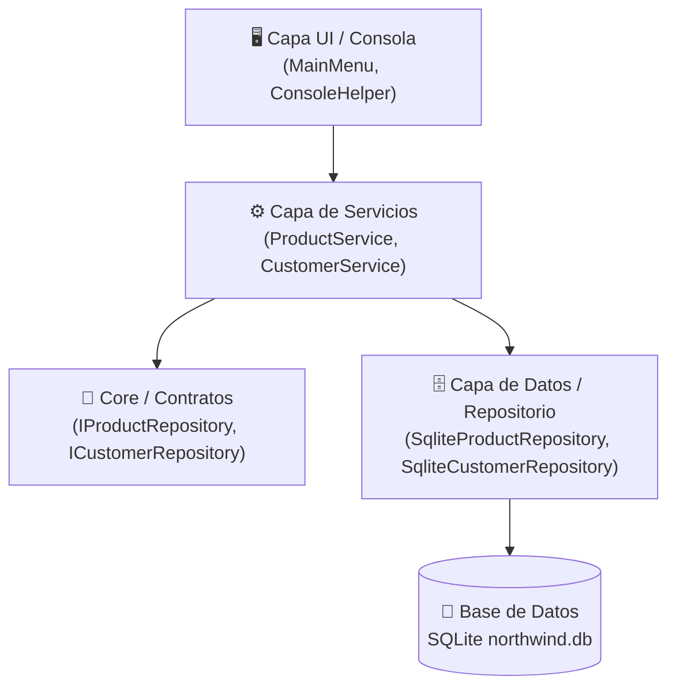

# 🚀 Tutorial C# desde Cero & Sistema de Gestión Northwind (`app01`)

[](https://dotnet.microsoft.com/)
[](https://docs.microsoft.com/dotnet/csharp/)
[](https://www.sqlite.org/)
[](#-arquitectura-del-sistema-app01)

Este repositorio combina un **tutorial integral paso a paso para aprender C# y .NET 8 desde cero** con un **sistema de consola profesional en Arquitectura en Capas (N-Layer)** conectado a la base de datos `Northwind` mediante **SQLite / ADO.NET**.

---

## 📚 Índice del Tutorial (`/docs`)

Toda la documentación teórica y práctica está organizada en el directorio [`docs/`](docs/). Haz clic en cualquiera de los capítulos para acceder al contenido completo:

| Capítulo | Título | Descripción y Temas Principales |
| :--- | :--- | :--- |
| 📘 **[Capítulo 1](docs/Tutorial_CS_Capitulo_1_Fundamentos.md)** | **Fundamentos de C# y .NET** | Tipos de datos primitivos, valor vs referencia, `Array`, colecciones genéricas (`List`, `Dictionary`, `Queue`, `Stack`), POO (Clases, Métodos, Interfaces, Herencia), excepciones y consultas **LINQ**. |
| 🛠️ **[Capítulo 2](docs/Tutorial_CS_Capitulo_2_Consola_Progresiva.md)** | **Consola Progresiva** | Estructuración modular de aplicaciones de consola, captura interactiva de teclado (`Console.ReadKey`, contraseñas ocultas) y formateo estético de salidas. |
| 🗄️ **[Capítulo 3](docs/Tutorial_CS_Capitulo_3_BaseDeDatos_Northwind.md)** | **Base de Datos Northwind** | Conexión e interacción con bases de datos relacionales usando **ADO.NET** pura y **SQLite** (`northwind.db`), prevención de **SQL Injection** con `SqlParameter`. |
| 🏛️ **[Capítulo 4](docs/Tutorial_CS_Capitulo_4_Proyecto_Final.md)** | **Proyecto Final N-Capas** | Diseño e implementación del sistema `app01` utilizando **Arquitectura en Capas** (`Core`, `Data`, `Services`, `UI`), Inyección de Dependencias y patrón Repositorio. |
| 💡 **[Capítulo 5](docs/Tutorial_CS_Capitulo_5_Solucionario.md)** | **Solucionario de Ejercicios** | Respuestas y explicaciones detalladas para todos los ejercicios prácticos propuestos en los capítulos 1 al 4. |
| 📚 **[Capítulo 6](docs/Tutorial_CS_Capitulo_6_Glosario_Y_Checklist.md)** | **Glosario y Checklist** | Glosario de 30 términos clave del ecosistema .NET (CLR, JIT, GC, Stack/Heap, ORM, etc.) y checklist progresivo de habilidades desde principiante hasta avanzado. |

---

## 🏛️ Arquitectura del Sistema (`app01`)

La aplicación principal (`app01`) implementa una **Arquitectura en Capas desacoplada**, garantizando mantenibilidad, testabilidad y separación de responsabilidades:



### Estrategia de Capas:

- **[`Core/`](Core/)**: Contiene las entidades del dominio ([`Product.cs`](Core/Entities/Product.cs), [`Customer.cs`](Core/Entities/Customer.cs), [`Category.cs`](Core/Entities/Category.cs)) y los contratos de acceso a datos ([`IProductRepository.cs`](Core/Interfaces/IProductRepository.cs), [`ICustomerRepository.cs`](Core/Interfaces/ICustomerRepository.cs)).
- **[`Data/`](Data/)**: Implementación física de persistencia usando ADO.NET con SQLite ([`DatabaseInitializer.cs`](Data/DatabaseInitializer.cs), [`SqliteProductRepository.cs`](Data/SqliteProductRepository.cs), [`SqliteCustomerRepository.cs`](Data/SqliteCustomerRepository.cs)).
- **[`Services/`](Services/)**: Lógica de negocio, reglas de validación y transformaciones ([`ProductService.cs`](Services/ProductService.cs), [`CustomerService.cs`](Services/CustomerService.cs)).
- **[`UI/`](UI/)**: Presentación en consola con menús interactivos, formato de tablas ANSI y captura segura ([`MainMenu.cs`](UI/MainMenu.cs), [`ConsoleHelper.cs`](UI/ConsoleHelper.cs), [`FundamentosRunner.cs`](UI/FundamentosRunner.cs)).

---

## ✨ Características Principales

- 📦 **100% Portátil y Autónomo**: Incluye base de datos SQLite pre-configurada (`northwind.db`) para ejecución inmediata sin instalaciones de servidores externos.
- 💉 **Inyección de Dependencias Manual**: Desacoplamiento total mediante inyección de dependencias por constructor en `Program.cs`.
- 🛡️ **Seguridad Antihackeo**: Consultas SQL parametrizadas para evitar ataques de SQL Injection.
- 🎨 **Interfaz de Consola Moderna**: Encabezados enriquecidos, menús interactivos con navegación por teclado y formateo alineado de datos tabular.
- 🧪 **Demostración de Fundamentos Integrada**: Permite ejecutar ejemplos interactivos de los conceptos teóricos explicados en el Capítulo 1 (Arrays, Colecciones, LINQ, POO).

---

## 🚀 Requisitos e Instalación

### Requisitos Previos

- [.NET 8.0 SDK](https://dotnet.microsoft.com/download/dotnet/8.0) o posterior.
- Windows, macOS o Linux.

### Pasos para Ejecutar

1. **Clonar el repositorio** o situarse en el directorio raíz del proyecto:
   ```bash
   cd c:\developer\app01
   ```

2. **Restaurar dependencias del proyecto**:
   ```bash
   dotnet restore
   ```

3. **Compilar el proyecto**:
   ```bash
   dotnet build
   ```

4. **Ejecutar la aplicación**:
   ```bash
   dotnet run
   ```

---

## 🛠️ Tecnologías Utilizadas

- **Lenguaje**: C# 12 / .NET 8.0
- **Persistencia**: ADO.NET (`Microsoft.Data.Sqlite`, `Microsoft.Data.SqlClient`)
- **Base de Datos**: SQLite (`northwind.db`)
- **Arquitectura**: Clean Architecture / N-Layer (Capas)

---

## 📝 Licencia

Este proyecto y su material tutorial están disponibles bajo los términos de la licencia [BSD 3-Clause License](LICENSE).