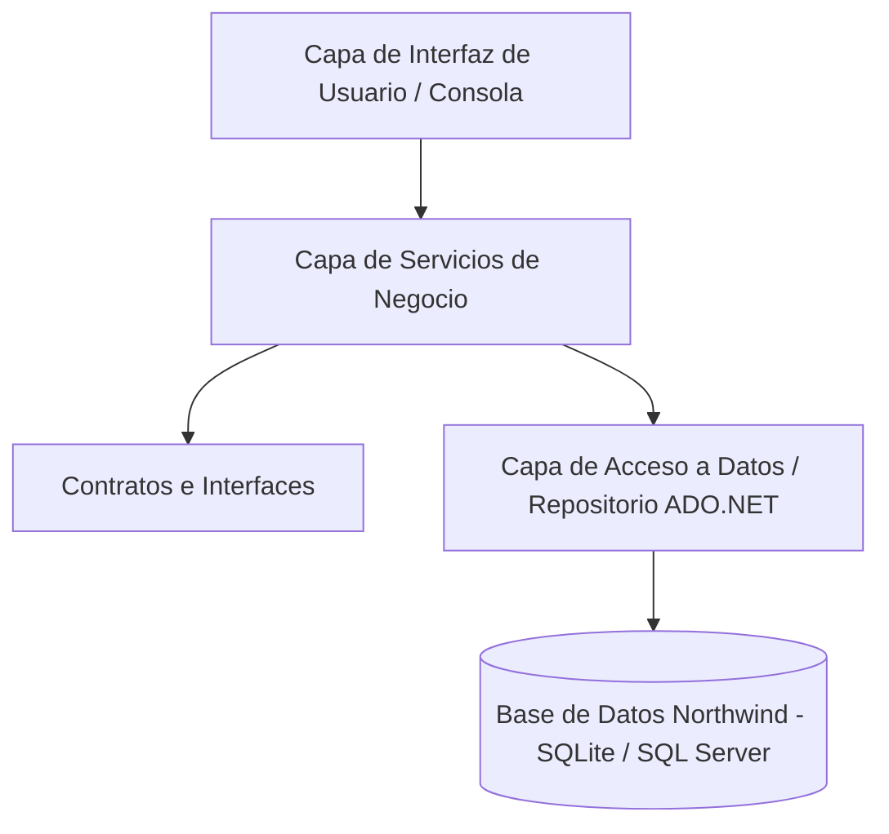

# Capítulo 4: Proyecto Final - Sistema de Gestión Northwind (Console App N-Capas)

En este capítulo explicamos la arquitectura, el diseño y la implementación del **Proyecto Final**: un mini-sistema de consola interactivo con operaciones CRUD reales conectadas a Northwind utilizando una **Arquitectura en Capas (N-Layer)**.

---

## 4.1 Arquitectura del Sistema

El proyecto sigue el patrón de separación de responsabilidades para mantener el código desacoplado, mantenible y testeable:



### Descripción de Capas:
1. **Core / Domain**: Contiene las entidades del dominio (`Product`, `Customer`), los DTOs y las interfaces de repositorio (`IProductRepository`, `ICustomerRepository`).
2. **Data**: Implementa las interfaces de acceso a datos usando ADO.NET y sentencias SQL parametrizadas.
3. **Services**: Contiene las reglas de negocio, validaciones y lógica de aplicación.
4. **UI**: Contiene el menú interactivo de consola, la captura de entradas del usuario, el manejo de colores de la consola y la renderización de tablas de salida.

---

## 4.2 Características Principales del Sistema Final

- **Menú Interactivo con Navegación por Consola**:
  - `1.` Gestión de Productos (Listar, Buscar, Crear, Actualizar Precio, Eliminar).
  - `2.` Gestión de Clientes (Listar por País, Buscar por ID, Crear Cliente).
  - `3.` Reporte Ejecutivo de Ventas / Inventario.
  - `0.` Salir.
- **Formateo Visual de Tablas ANSI**: Salida formateada con columnas alineadas, encabezados destacados y separadores visuales.
- **Resiliencia ante Errores**: Captura centralizada de excepciones para evitar que la aplicación colapse.
- **Doble Proveedor de Datos**: Compatible de forma nativa con **SQLite** (portátil e incluido por defecto) y **SQL Server**.

---

## 4.3 Estructura del Código del Proyecto Final

El código fuente ejecutable del proyecto final se encuentra disponible en la carpeta `/src/NorthwindSystem/`:

```
c:\developer\app01\src\NorthwindSystem\
├── NorthwindSystem.csproj
├── Program.cs
├── Core/
│   ├── Entities/
│   │   ├── Product.cs
│   │   └── Customer.cs
│   └── Interfaces/
│       ├── IProductRepository.cs
│       └── ICustomerRepository.cs
├── Data/
│   ├── DatabaseInitializer.cs
│   ├── ProductRepository.cs
│   └── CustomerRepository.cs
├── Services/
│   ├── ProductService.cs
│   └── CustomerService.cs
└── UI/
    ├── ConsoleHelper.cs
    └── MainMenu.cs
```
